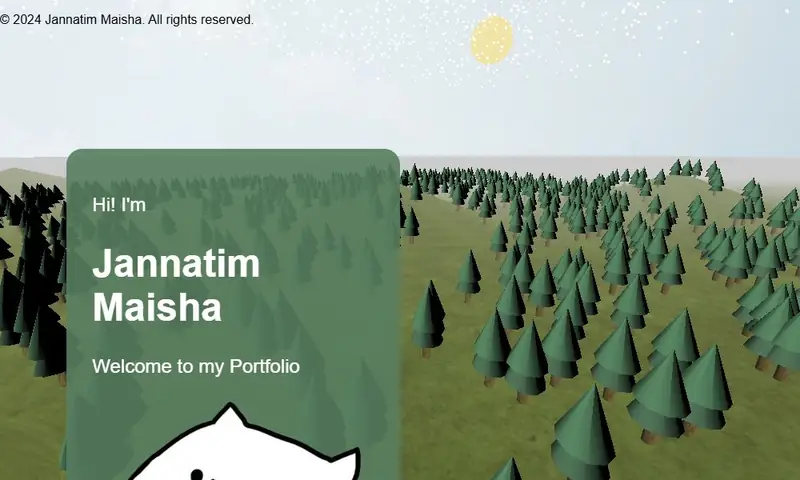

A selection of things I've built, from research prototypes to apps and games.
All code is on my [GitHub](https://github.com/jannatim-maisha).

## Research & robotics

* **Contactless stress detection.** Heart and breathing rate from two webcams (rPPG) fused with mmWave radar, plus eye tracking and facial-emotion cues, logged for multimodal stress analysis. *(BDI Lab, in progress)*
* **CareBot: medication-delivery robot.** A GoPiGo3 robot for dementia care. It finds the patient with its camera (TensorFlow Lite), plans around obstacles with A\*, explains each decision on a live dashboard, and is called from a Wear OS smartwatch app. *(CSC 4120 Robotics, Fall 2026)*

## Machine learning

* **[Singer identification for Bangla songs](https://github.com/jannatim-maisha/Softcom_lab_project).** Deep-learning singer identification from audio spectrograms.
* **[Step-by-step machine learning](https://github.com/jannatim-maisha/Step-by-Step-Machine-Learning).** Beginner notebooks on linear regression, label/one-hot encoding and dummy variables with scikit-learn.

## Apps, web & games

* **[3D portfolio](https://jannatim-maisha.github.io/Portfolio_threejs_JM/).** An interactive Three.js world that changes seasons as you scroll.
* **[AustPIC website](https://github.com/jannatim-maisha/AustPIC_official_main).** The AUST programming club's website (ASP.NET Core 6, C#, SQL Server). Champion, Intra AUST Software Exhibition 2024.
* **[Helping Hand](https://github.com/jannatim-maisha/Helping-Hand).** A community, reward-driven service app for Android (Kotlin, Firebase).
* **[Stockpile management](https://github.com/jannatim-maisha/customer-handling-and-stockpile-management).** A desktop system for customers, suppliers, stock, sales and invoices (Java Swing, SQL Server, JasperReports).
* **[Pet health manager](https://github.com/jannatim-maisha/pet-health-manager).** A distributed database with horizontal fragmentation across sites (Oracle PL/SQL).
* **[IT support system](https://github.com/jannatim-maisha/IT-SUPPORT-AND-MAINTENANCE-SYSTEM).** A web app for service requests, technician assignment, assets and sales (PHP, MySQL).
* **[Dead Block](https://github.com/jannatim-maisha/dead_block).** A top-down zombie shooter in C# Windows Forms.
